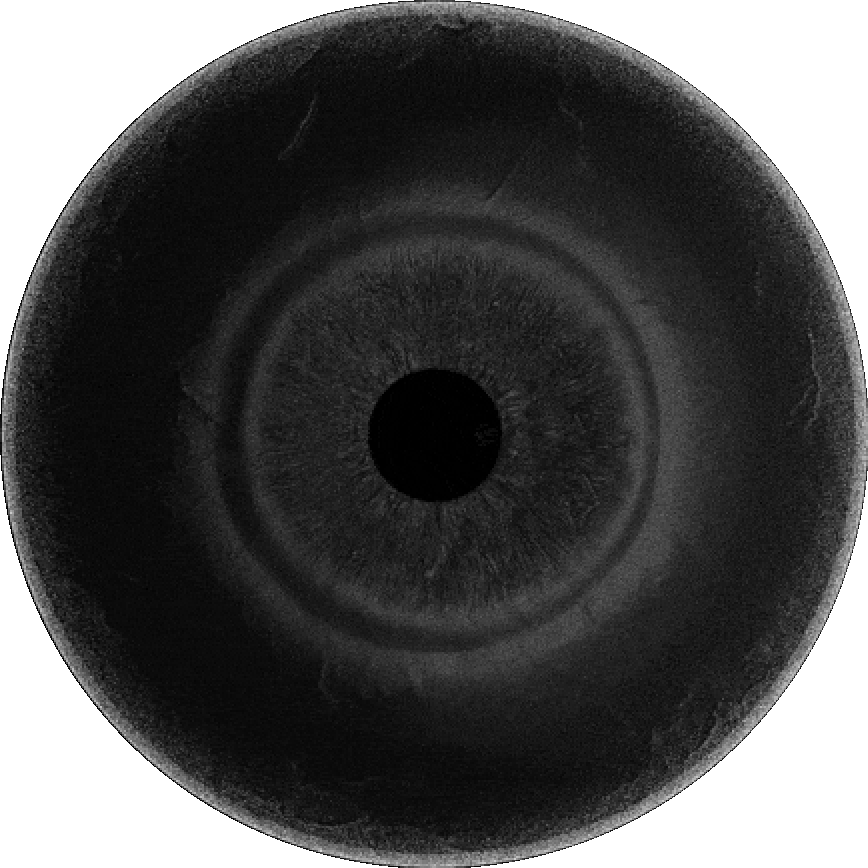
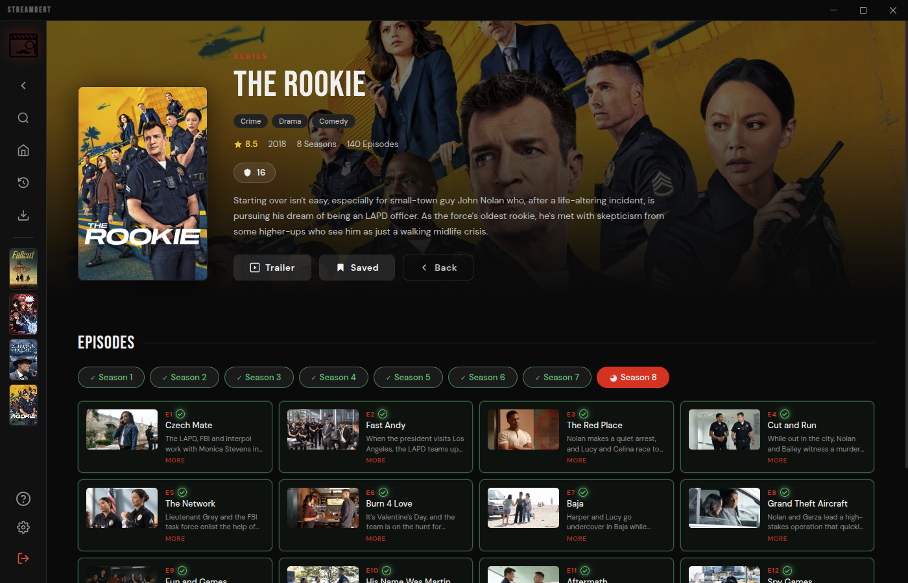
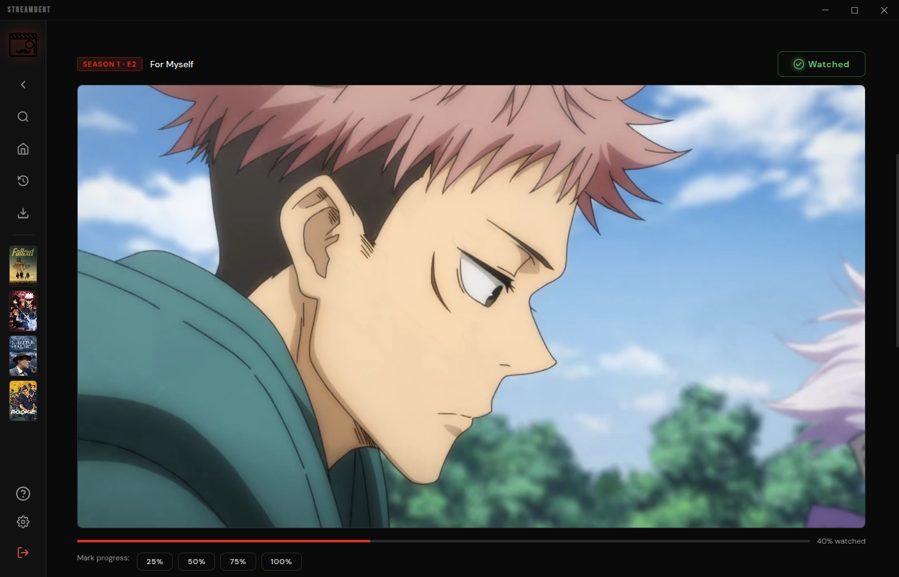
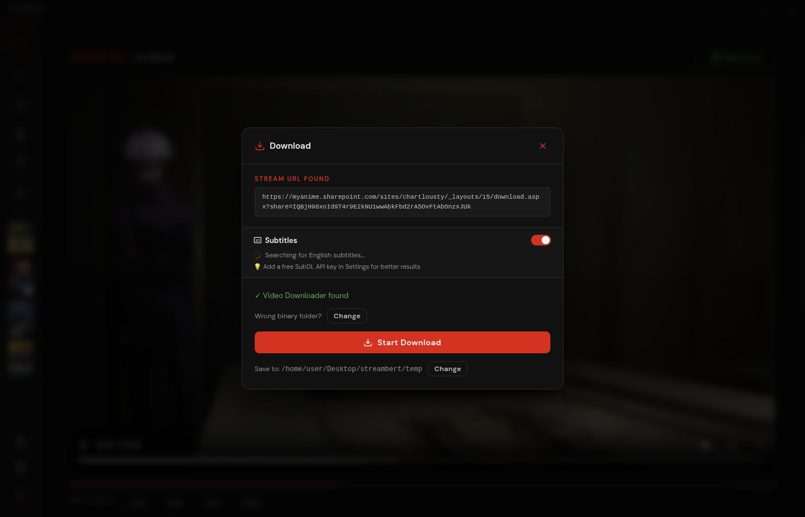
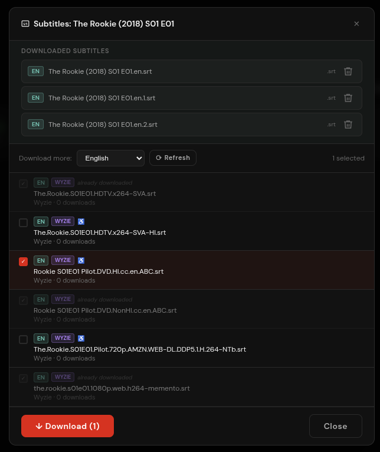
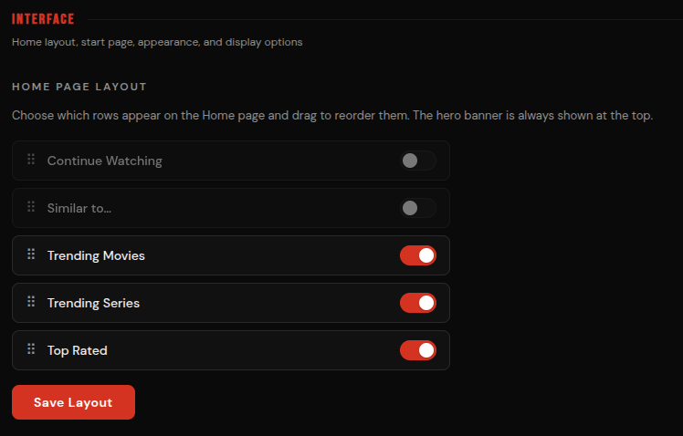
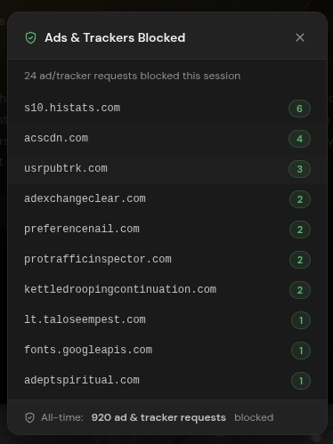

<div align="center">

  

  # 👁 The Watcher

  **Stream & download any Movie, TV Series or Anime — zero ads, zero tracking.**

  [](https://github.com/zakariaelqannaadv/the-watcher/releases/latest)
  [](LICENSE)
  [](https://github.com/zakariaelqannaadv/the-watcher/releases/latest)
  [](https://github.com/zakariaelqannaadv/the-watcher/releases/latest)
  [](https://github.com/zakariaelqannaadv/the-watcher/releases/latest)

  [Features](#-features) · [Screenshots](#-screenshots) · [Installation](#-installation) · [Get your API key](#-get-your-own-tmdb-api-key) · [Build from source](#-building-from-source)

</div>

---

## ✨ Features

| | What you get |
|---|---|
| 🎦 **Streaming** | Watch any movie, series or anime from multiple sources (Videasy, VidSrc, Vidking, AllManga for anime) |
| 📥 **Downloading** | Download anything via multithreaded downloader and keep the files |
| 📃 **Subtitles** | Search & download subtitles (SubDL + Wyzie), auto-matched to your files |
| 📚 **Library** | Watchlist, continue-watching with progress, watch history, download manager |
| ✨ **Trending** | Discover what's popular every day, with recommendations |
| 🎨 **Customizability** | Themes, accent colors, fonts, compact mode, custom home rows |
| 🎮 **Extras** | Controller/gamepad navigation, Discord Rich Presence, new-episode notifications, trailer pop-out player |
| 🛡️ **Privacy** | No ads, no tracking — built-in ad/tracker blocker |
| ⚡ **Speed** | Native desktop playback, faster than any browser tab |

---

## 📸 Screenshots

| Trending | Movies |
|:---:|:---:|
|  |  |

| Series | Anime |
|:---:|:---:|
|  |  |

| Downloads | Subtitles |
|:---:|:---:|
|  |  |

| Customize | Ad-blocking |
|:---:|:---:|
|  |  |

---

## 🎞️ How it works

**Streaming** — Metadata, search, posters and trending come from [TMDB](https://www.themoviedb.org/) (needs your free key, see below). Anime metadata comes from [AniList](https://anilist.co/). Video streams come from third-party providers; switch sources anytime in the player.

**Downloading** — The app captures the stream's `.m3u8` playlist and downloads it with [vid-dl-cli-only](https://github.com/truelockmc/vid-dl-cli-only) + [ffmpeg](https://ffmpeg.org/download.html). Watch in-app or take the files anywhere.

**Anime** — If a title is detected as anime, artwork/synopsis load from AniList and episodes stream as direct `.mp4` files via AllManga.

---

## 📋 Requirements

- A **free TMDB API Read Access Token** ([get one in ~2 minutes](#-get-your-own-tmdb-api-key))
- For downloading: [vid-dl-cli-only](https://github.com/truelockmc/vid-dl-cli-only/releases/latest) + [ffmpeg](https://ffmpeg.org/download.html)
- Optional: free [SubDL](https://subdl.com/) key for more subtitle results ([guide](wyzie-tutorial.md))

---

## 🔑 Get your own TMDB API key

Everyone uses **their own** key — never share or reuse someone else's token.

1. **Create a free account** — [sign up](https://www.themoviedb.org/signup) (or [log in](https://www.themoviedb.org/login)).
2. **Request a key** — open [API Settings](https://www.themoviedb.org/settings/api) → click to request → choose **Personal use only** → confirm.
3. **Fill the form** → press **Subscribe**. (Placeholder info is fine.)
4. **Copy the API Read Access Token** — the long one starting with `eyJ` (not the short API Key). Full walkthrough with pictures: [`tmdb-tutorial.md`](tmdb-tutorial.md).
5. **Paste it into The Watcher** on first launch → **Let's go**. Done — you only do this once.

> 🔒 **Keeping your key secure**
> - The Watcher stores your token **encrypted in your OS keychain** (via Electron `safeStorage`) — never in plain text, never in the repo.
> - Never paste your token into chats, screenshots, issues or code. If you ever leak it, regenerate it in TMDB API Settings and re-enter the new one in The Watcher (Settings → change token).
> - This repository contains **no secrets** — only code. `node_modules/`, `dist/` and `*secret.txt` are git-ignored.

---

## 💾 Installation

| OS | How |
|---|---|
| 🪟 **Windows** | Download `The Watcher Setup *.exe` from [latest release](https://github.com/zakariaelqannaadv/the-watcher/releases/latest) and run it |
| 🍎 **macOS** | Download `The Watcher-*-universal.dmg`, open it, drag The Watcher to Applications |
| 🐧 **Linux** | Download `.deb` / `.pacman` / `.AppImage` from [latest release](https://github.com/zakariaelqannaadv/the-watcher/releases/latest) |
| | ```bash # .deb sudo dpkg -i the-watcher_*.deb # Arch (.pacman) sudo pacman -U the-watcher-*.pacman # .AppImage chmod +x "The Watcher"-*.AppImage && ./"The Watcher"-*.AppImage ``` |

On first launch you'll be asked for your TMDB token ([guide](#-get-your-own-tmdb-api-key)).

---

## 🔨 Building from source

```bash
npm install
npm run dist:mac      # macOS (.dmg)
npm run dist:win      # Windows (.exe)
npm run dist:linux    # deb + rpm + AppImage + pacman
npm run dist:deb      # .deb only
npm run dist:rpm      # .rpm only
npm run dist:arch     # Arch pacman only
npm run dist:appimage # AppImage only
npm run dist          # everything
```

> [!IMPORTANT]
> On Arch Linux you may need: `sudo pacman -S libxcrypt-compat`, and `yay -S http-parser` (AUR).
>
> Requires Node.js ≥ 22.12.0. Dev mode: `npm run dev` (watch) or `npm run start` (build + run Electron).

<details>
<summary>Project structure</summary>

```
Project Root
├── index.html / index.js / preload.js / popout-preload.js
├── package.json / vite.config.js
├── public/          # icon, logo, installer assets
├── screenshots/
└── src
    ├── App.jsx / main.jsx
    ├── components/  # Sidebar, SearchModal, SetupScreen, modals, player UI…
    ├── ipc/         # main-process: player, downloads, storage, subtitles, allmanga…
    ├── pages/       # Home, Movie, TV, Library, Downloads, Settings
    ├── styles/      # global.css + fonts (DM Sans, Bebas Neue)
    └── utils/       # api, storage, appearance, backup, updates, subtitles…
```

</details>

---

## 🤝 Contributing

Everyone is welcome! Please read [`CONTRIBUTING.md`](CONTRIBUTING.md) first. Report bugs or request features in [Issues](https://github.com/zakariaelqannaadv/the-watcher/issues).

## 📄 License

GPL-3.0 — see [LICENSE](LICENSE). Forks must stay open-source.

## 🛡️ Privacy disclaimer

The Watcher itself collects **no data** and needs no central server. Streaming providers and GitHub (in-app update checks) may collect data on their side. Built-in ad/tracker blocking helps but isn't perfect.

## ⚖️ Legal disclaimer

**For educational and personal use only.** The Watcher hosts nothing — it aggregates third-party sources like a search engine. You are responsible for having the rights to anything you watch and for complying with your local laws. Direct complaints to the actual content providers.
